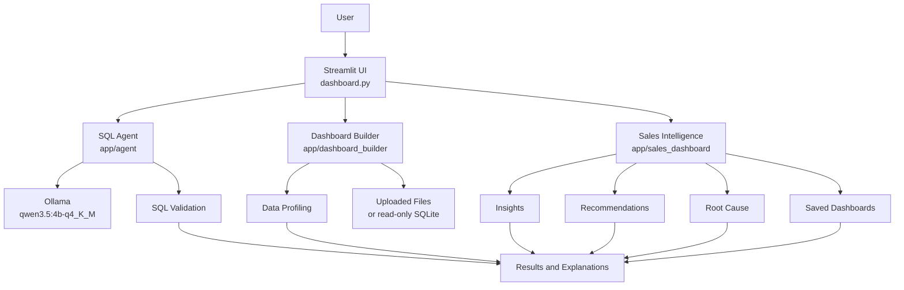
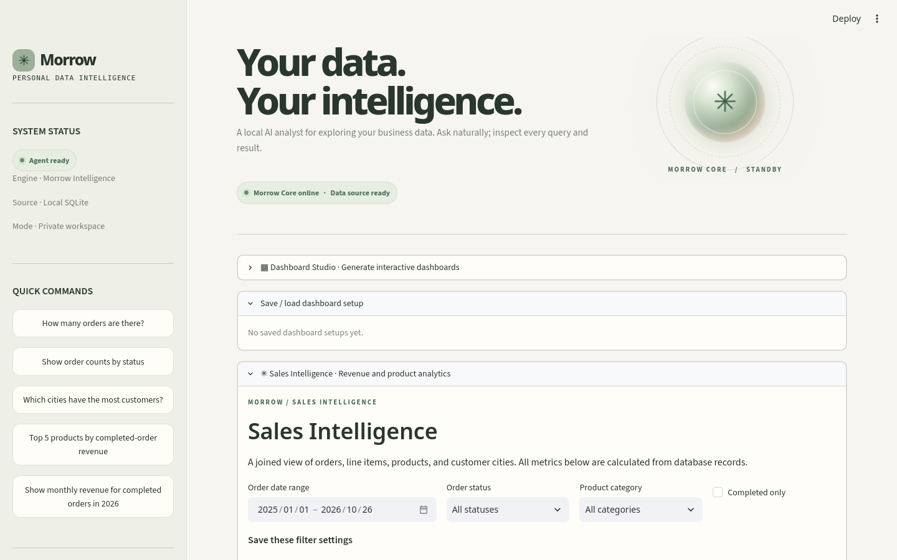
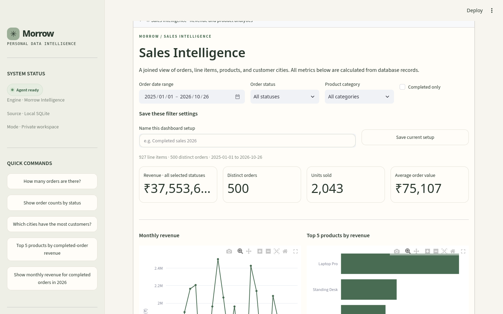
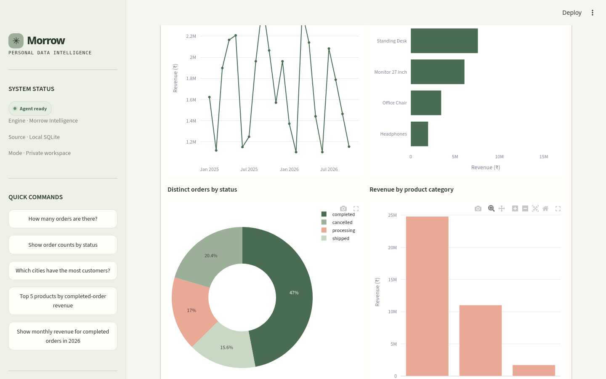
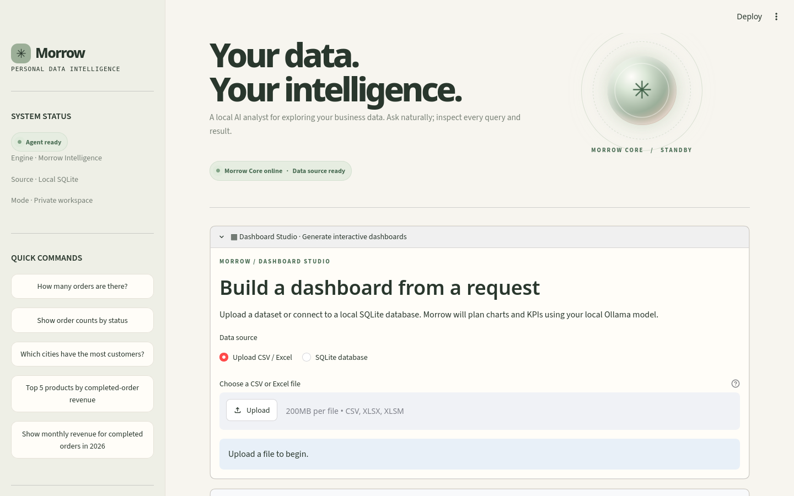
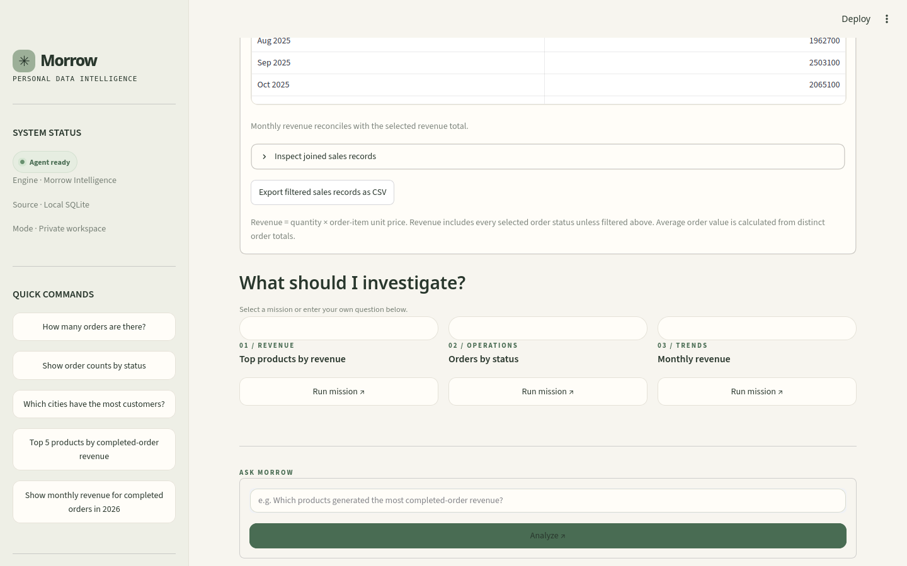
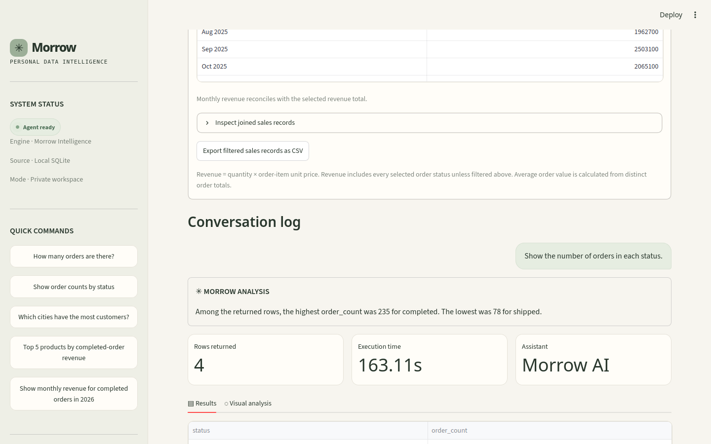
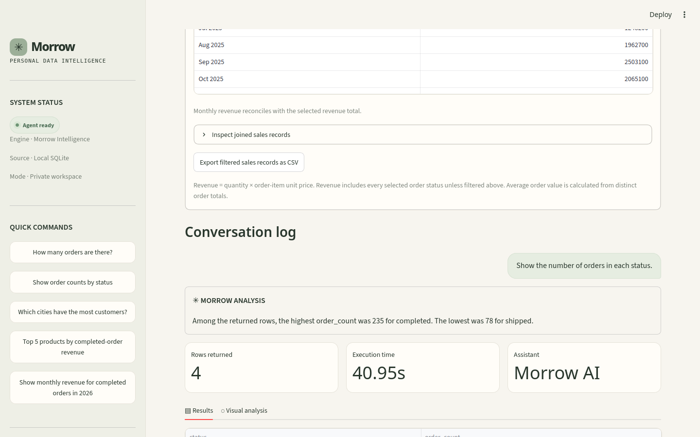
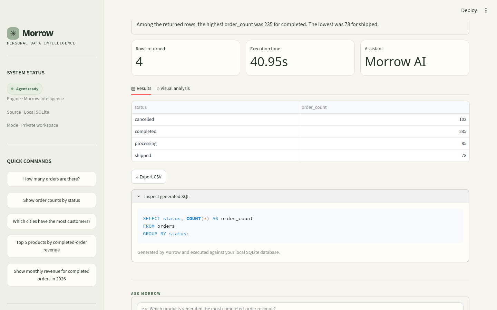

# Morrow - AI-Powered Data Analyst


Morrow is a local-first AI analytics application for asking business questions
in natural language, generating dashboards, and exploring business insights.
It combines Python, Streamlit, SQLite, and a locally hosted Ollama model.


> **Status:** Active development; local prototype


## Overview


Morrow is designed to make data analysis more accessible without hiding the
SQL or analytical process. The application includes:


- A natural-language SQL agent for read-only SQLite analysis.
- An AI dashboard builder for uploaded datasets and SQLite databases.
- Sales intelligence features for insights, comparisons, recommendations, and
  root-cause analysis.
- Interactive tables, visualizations, and saved dashboard controls.


## Architecture





## Screenshots


*Home hero*


*Sales Intelligence KPIs (Revenue ₹37,553,600, 500 orders)*


*Sales Intelligence charts*


*Dashboard Studio*


*Ask Morrow*


*Live NL-to-SQL answer*


*NL question results table*


*Full results table + generated SQL*


## Technology Stack


- Python 3.12
- Streamlit
- Pandas
- Plotly
- SQLite
- Ollama with `qwen3.5:4b-q4_K_M`
- openpyxl for Excel uploads


## Requirements


- Python 3.12 or a compatible version.
- Ollama installed and running locally.
- The `qwen3.5:4b-q4_K_M` model available in Ollama.


## Installation


Clone the repository and enter its directory:


```bash
git clone https://github.com/pawan-aicode/morrow-ai-data-analyst.git
cd morrow-ai-data-analyst
```


Create and activate a virtual environment:
