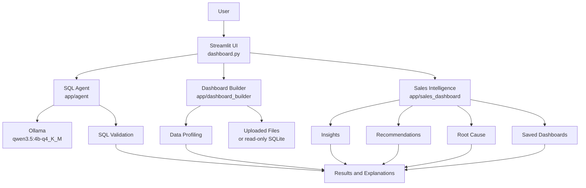

# Morrow - AI-Powered Data Analyst

Morrow is a local-first AI analytics application for asking business questions
in natural language, generating dashboards, and exploring business insights.
It combines Python, Streamlit, SQLite, and a locally hosted Ollama model.

> **Status:** Active development; local prototype

## Overview

Morrow is designed to make data analysis more accessible without hiding the
SQL or analytical process. The application includes:

- A natural-language SQL agent for read-only SQLite analysis.
- An AI dashboard builder for uploaded datasets and SQLite databases.
- Sales intelligence features for insights, comparisons, recommendations, and
  root-cause analysis.
- Interactive tables, visualizations, and saved dashboard controls.

## Architecture



## Technology Stack

- Python 3.12
- Streamlit
- Pandas
- Plotly
- SQLite
- Ollama with `qwen3.5:4b-q4_K_M`
- openpyxl for Excel uploads

## Requirements

- Python 3.12 or a compatible version.
- Ollama installed and running locally.
- The `qwen3.5:4b-q4_K_M` model available in Ollama.

## Installation

Clone the repository and enter its directory:

```bash
git clone https://github.com/pawan-aicode/morrow-ai-data-analyst.git
cd morrow-ai-data-analyst
```

Create and activate a virtual environment:

```bash
python3 -m venv .venv
source .venv/bin/activate
```

Install the application dependencies:

```bash
pip install -r requirements.txt
```

Pull the configured Ollama model:

```bash
ollama pull qwen3.5:4b-q4_K_M
```

## Database Setup

The sample database is intentionally excluded from GitHub as
`data/sales.db`. It is local application data and is not part of the published
repository.

The application expects a compatible SQLite database at:

```text
data/sales.db
```

You can provide your own compatible database by creating the `data` directory
and copying the database to that path:

```bash
mkdir -p data
cp /path/to/your/sales.db data/sales.db
```

The repository also contains
[`scripts/create_database.py`](scripts/create_database.py), which is intended
to generate the sample sales database at that same path. From the repository
root, its intended command is:

```bash
python3 scripts/create_database.py
```

The generator creates 20 customers, 10 products, 500 orders, and related order
items using deterministic, synthetic data. It recreates the four tables on each
run, so rerunning the command does not duplicate records. The generated
database is ignored by Git and remains local to your checkout.

The dashboard builder can also analyze uploaded CSV and Excel files, so a
SQLite database is not required for those workflows.

## Running the Application

From the repository root, with the virtual environment activated:

```bash
streamlit run dashboard.py
```

The application uses the local Ollama service for SQL generation and analysis.

## Running Tests

Install the development dependencies:

```bash
pip install -r requirements-dev.txt
```

Run the test suite:

```bash
pytest -q
```

The latest recorded result is **178 passed, with 27 subtests passed**. This is
a historical result, not a guarantee for every environment or future change.

## SQL Benchmark

The custom benchmark contains 30 questions across six categories: basic
queries, filtering, aggregation, joins, ranking, and advanced queries.

| Run | Correct | Accuracy |
| --- | ---: | ---: |
| Initial baseline | 28/30 | 93.33% |
| After prompt modification | 27/30 | 90% |

The second run was lower than the initial baseline; it should not be read as an
improvement. These results come from a small custom benchmark, not a
standardized evaluation. Model output can vary between runs.

## Limitations

- SQL generation depends on the locally configured Ollama model.
- Generated SQL is restricted to read-only operations.
- The benchmark contains only 30 test cases.
- Results depend on the model, prompt, and database schema.
- The application currently targets a local development environment.
- No deployment or production hosting configuration is included.

## Future Improvements

- Repair and validate the sample database-generation script.
- Expand SQL benchmark coverage.
- Improve complex join and ranking query generation.
- Add more dataset formats and profiling capabilities.
- Improve error handling and query explanations.
- Add deployment and production monitoring.

## License

No open-source license has been selected yet. All rights reserved by default.
